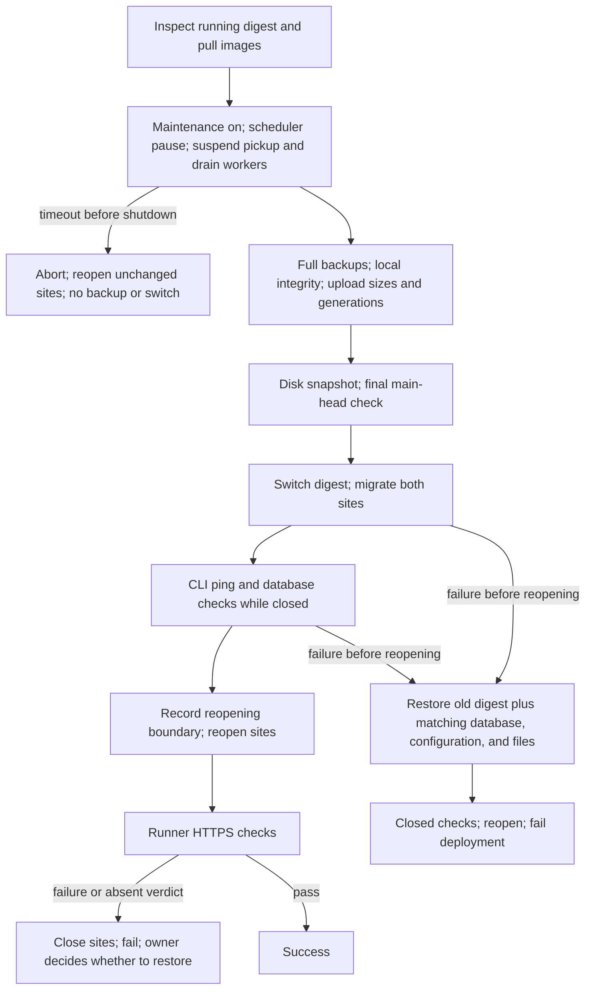

# Production deployment (GCP)

This file is public. Real project IDs, IP addresses, account names and bucket names are replaced with `<PLACEHOLDERS>`. The real values are in the team's private notes.

Verified on 2026-10-03 by read-only inspection of the VM and the GCP project.
This file holds no secrets. Passwords and keys are in the `.env` file on the VM.

## Summary

Brisk HRMS runs as a Docker Compose stack on one Compute Engine VM.
Nginx on the VM terminates TLS and proxies to the stack.
The stack serves two Frappe sites from one bench:

- `hrms.briskflow.ai`
- `crm.briskflow.ai`

## Where it runs

| Item            | Value                                                        |
| --------------- | ------------------------------------------------------------ |
| GCP project     | `<GCP_PROJECT_ID>`                                     |
| VM              | `brisk-hrms`, `e2-medium` (2 shared vCPU, 4 GB), zone `asia-south1-a`. Resized from `e2-standard-2` on 2026-10-03          |
| Static IP       | `brisk-hrms-ip` = `<STATIC_IP>`                             |
| Disk            | `brisk-hrms`, 100 GB `pd-balanced` (root file system: 49 GB) |
| Service account | `<VM_SERVICE_ACCOUNT>` |
| Network         | `default` VPC, network tag `brisk-hrms`                      |
| Firewall        | `brisk-hrms-http` (80) and `brisk-hrms-https` (443) from the internet |
| SSH             | Port 22 is open to IAP only (`allow-ssh-iap`)                |
| Image registry  | `<REGION>-docker.pkg.dev/<GCP_PROJECT_ID>/brisk-hrms` |

## Request path

Internet → nginx (ports 80 and 443) → upstream `brisk_frappe` → `frontend` container.

- Nginx site file: `/etc/nginx/sites-enabled/brisk-hrms`.
- The TLS certificate is from Let's Encrypt. Certbot manages it.

## Production stack

Compose project: `brisk-hrms`. Directory on the VM: `<DEPLOY_DIR>` (a user's home directory; see the private notes).

Image: `erpnext-hrms-crm:v16-briskrew-20261004` (ERPNext v16, HRMS from this fork's `version-16-briskrew` branch, CRM). The image tag is the `IMAGE=` line in `.env` on the VM. Rollback image: `v16-20260901` (upstream HRMS).

| Container     | Role                       |
| ------------- | -------------------------- |
| `frontend`    | Web server on port 8080 (localhost only) |
| `backend`     | Gunicorn application server |
| `scheduler`   | Scheduled jobs             |
| `websocket`   | Realtime events            |
| `queue-short` | Short background jobs      |
| `queue-long`  | Long background jobs       |
| `mariadb`     | `mariadb:10.11` database   |
| `redis-cache` | `redis:6.2-alpine`         |
| `redis-queue` | `redis:6.2-alpine`         |

Docker volumes: `brisk-hrms_sites`, `_mariadb-data`, `_logs`, `_redis-cache-data`, `_redis-queue-data`.

## Build and deploy a version

A successful `briskrew` push check on `main` triggers the image build for that exact commit.
Owner decision, 2026-10-13: one required reviewer, the owner, approves `production`. Self-review is permitted.
The workflow has no pull-request trigger and rejects failed CI, foreign repositories, and non-main dispatches.

### Build provenance

The pinned `frappe_docker` layered build clones apps through `bench init` and `apps.json`.
It has no direct hook for a checked-out HRMS directory. The pipeline uses build choice **(b)**.
The workflow creates `build-<sha12>` and verifies its target against the full tested SHA, including annotated-tag targets.
An existing mismatched tag fails the build. GitHub source tags must be protected against update and deletion.
Before removing Git metadata, the build checks the cloned HRMS HEAD against that full SHA.
The resulting image has the full SHA in `org.opencontainers.image.revision`.
An existing registry image must have the same label. Artifact Registry tag immutability is mandatory.
The reviewer approves the image digest; the automatic deploy uses that digest without resolving its tag again.
Only the non-secret `sha256:` digest crosses from build to deploy; the plan passes only booleans, the source SHA, and the tag.
The deploy job rebuilds the full reference from its own secrets and validates the digest form.
VM preflight pulls that exact digest and requires its revision label to equal the tested SHA before the write freeze.
Manual deploys retain their ancestry and matching-backup checks.
The build job needs `contents: write` for source-tag creation. Other jobs use read-only repository access.
`deploy/build.env` pins the build inputs. Change app versions through a reviewed pull request.
GitHub Actions builds the image on its Ubuntu runner with the preinstalled Docker Buildx and BuildKit.
The rendered `apps.json` is a BuildKit secret named `apps_json`, never a build argument.
The build uses the pinned layered Containerfile, all four build arguments, and the full source revision label.
Docker loads the image locally, then pushes it with a fresh builder WIF access token. No service account key is used.
After push, the workflow reads the registry digest, pulls that digest, and verifies its source revision label.

The runner removes unused .NET and Android SDKs before a new build.
The workspace and Docker storage must each have at least 24 GiB free after cleanup, or the job fails clearly.
An existing image skips cleanup, rendering, and building, but still passes the digest and source revision checks.
The build-and-push step has a 60-minute limit. The whole build job has a 90-minute limit, including setup and verification.
Runner speed and peak disk use still need a real build to confirm these limits.

### Manual image build

Use a separate Linux build machine with Docker Buildx, Git, Python, `jq`, `envsubst`, and the Cloud SDK.
Do not build on the production VM while it serves traffic.
Supply the repository secret values through your shell. Never save real infrastructure values in this public repository.
Use the tested full `SHA` and repository name as `GITHUB_REPOSITORY`.
Authenticate through WIF as `BUILDER_SERVICE_ACCOUNT`; the workflow uses `WIF_PROVIDER_BUILD`.

From the repository root, repeat these workflow steps before the command below:

1. Read `deploy/build.env` and check out `frappe_docker` at `FRAPPE_DOCKER_SHA` into `frappe_docker/`.
2. Run **Verify or create the exact HRMS source tag**. Export its verified `HRMS_REF` for the rendering step.
3. Run **Require immutable tags and resolve existing image** with `TAG=${IMAGE_TAG_PREFIX}-${SHA:0:12}`.
4. If the tag exists, skip the build and run **Bind the built image to the full SHA and digest**.
5. For a new tag, check at least 24 GiB free in the workspace and Docker storage.
6. Run **Render apps.json**, including its Containerfile patch that checks the cloned HRMS HEAD.

Use Bash. The following command assumes these preparation steps passed and the image tag does not exist:

```bash
set -euo pipefail
# shellcheck disable=SC1091
source deploy/build.env
IMAGE="${GCP_REGION}-docker.pkg.dev/${GCP_PROJECT_ID}/${AR_REPOSITORY}/${IMAGE_NAME}:${IMAGE_TAG_PREFIX}-${SHA:0:12}"
DOCKER_BUILDKIT=1 docker buildx build --load \
  --secret id=apps_json,src=frappe_docker/apps.json \
  --build-arg "FRAPPE_BRANCH=$FRAPPE_REF" \
  --build-arg FRAPPE_PATH=https://github.com/frappe/frappe \
  --build-arg "CACHE_BUST=$SHA" \
  --build-arg "HRMS_SOURCE_SHA=$SHA" \
  --label "org.opencontainers.image.revision=$SHA" \
  --tag "$IMAGE" \
  --file frappe_docker/images/layered/Containerfile \
  frappe_docker
gcloud auth print-access-token | docker login "${GCP_REGION}-docker.pkg.dev" \
  --username oauth2accesstoken --password-stdin
docker push "$IMAGE"
digest="$(gcloud artifacts docker images describe "$IMAGE" --project "$GCP_PROJECT_ID" --format='value(image_summary.digest)')"
[[ "$digest" =~ ^sha256:[0-9a-f]{64}$ ]]
immutable="${IMAGE%:*}@$digest"
docker pull "$immutable"
revision="$(docker image inspect "$immutable" --format '{{index .Config.Labels "org.opencontainers.image.revision"}}')"
[[ "$revision" == "$SHA" ]] || { echo 'Image source revision does not match the tested SHA.'; exit 1; }
printf 'Verified image: %s\n' "$immutable"
```

### Supervised deployment and write boundary

One detached systemd service runs the entire operation on the VM.
One `flock` covers backup, snapshot, switch, migration, checks, and any recovery.
The workflow polls the durable record and sends the result of its outside HTTPS checks.
SSH loss does not stop the service because systemd, rather than SSH, owns it.
TERM, INT, HUP, and ERR stop the named one-off command container before recovery.
Recovery uses a fresh Bash process with the same locked descriptor. Failed restore commands leave writers stopped.
A 90-minute runtime limit bounds the service. Its termination grace allows 15 minutes for recovery.
A reboot, forced kill, or failed recovery leaves a durable record that blocks ordinary deployment.

Each run has `/var/lib/brisk-deploy/<RUN_ID>-<ATTEMPT>/record.json` and a persistent copy of the script and request.
The record includes phase, the previous full image digest, backup folder, snapshot name, and the reopening boundary.
The service journal is `brisk-deploy-<RUN_ID>-<ATTEMPT>.service`.
The operation reads the previous image from the application containers' image IDs and repository digests, never from `.env`.
It requires all application services to agree and verifies that the previous digest remains available.



The closed phase follows this order:

1. Set maintenance mode on and pause the scheduler for both sites.
2. Suspend RQ pickup. Wait at most ten minutes until every controlled worker is idle or suspended with no active job. RQ 2.x idle workers never report suspension. Refuse any unknown registered worker.
3. If draining fails before worker shutdown, abort and reopen unchanged sites. Take no backup, snapshot, or image switch. Never force-kill a job.
4. After drain proof, record pending worker IDs, then stop workers with unlimited Docker grace. Verify zero exit status with no OOM. Stop the web writers: frontend, websocket and scheduler ignore SIGTERM and hold no data, so they get 10 seconds; backend gets 300 seconds.
5. Take a full backup with files into a unique directory for each deployment and site.
6. Check nonempty database, site configuration, public files, and private files. Check JSON, gzip, and tar integrity.
7. Upload each component with a create-only generation precondition. Use exact-object resumable API insertion. Verify its size and MD5; record its generation and SHA256.
8. Upload a manifest that binds both sites, their components, and the previous immutable image.
9. Snapshot the deployment disk with a name that includes the run ID and run attempt.
10. Reject an automatic request whose tested SHA no longer equals the public `main` head immediately before switching.
11. Switch to the approved digest and migrate both sites while every application writer stays stopped.
12. Run `bench --site <site> execute frappe.ping` and a database read for both closed sites.
13. Record the reopening boundary before the first maintenance-off operation. Resume the scheduler and start workers and web services.
14. Check both sites over HTTPS from the runner, including `/flow` and its linked script. Retry startup readiness within the record's ten-minute verdict lease, with time reserved for delivery.


The closed check uses Frappe's documented `bench execute` CLI, not an HTTP maintenance bypass.
The v16 command initializes the site and database without the HTTP maintenance gate.
Python helpers use the bench virtual environment and explicitly select its sites directory, as the pinned image layout requires.
Each site backup lives under `gs://<BACKUP_BUCKET>/production-stack/deploys/<TIMESTAMP>-<RUN_ID>-<ATTEMPT>/<SITE>/`.
This differs from the nightly backup's dated folders and never selects backup files by creation time.
Staging uses `sites/.brisk-deploy/<RUN_ID>-<ATTEMPT>/`, outside every site's managed backup directory.
The manifest records exact object generations and each site's database scheduler setting. Recovery downloads those generations and checks hashes and integrity again.

### Failure and restore policy

Before reopening, failed migration or closed checks restore the old digest and the matching database, site configuration, and both file sets.
Restore removes file contents absent from the saved backup, rather than overlaying only existing files.
It explicitly restores and verifies each site's database scheduler setting. Clearing `pause_scheduler` alone does not enable scheduled jobs.
It checks the restored sites while closed and then reopens them. The deployment still fails.
No user writes occur between the pre-deploy backup and this automatic restore because all application writers stay stopped.
If recovery fails, the operation leaves writers stopped and records `needs_owner`.
A normal pre-switch failure reopens the unchanged stack without replacing `.env` or recreating worker containers.
If worker shutdown started, recovery completes all recorded pending stops before restarting existing containers.
It verifies running workers and RQ registration before recording a terminal state. Otherwise it records `needs_owner`.
This access-recovery path never replaces the full restore required after mutation.

**Owner decision, 2026-10-13:** after reopening, a failed or missing HTTPS verdict closes both sites and fails the run.
It never restores automatically at this point. A restore could discard writes after reopening.
The summary names the backup folder, snapshot, and this exact owner command with the actual run ID and attempt:

```bash
sudo /var/lib/brisk-deploy/<RUN_ID>-<ATTEMPT>/deploy-on-vm.sh recover <RUN_ID>-<ATTEMPT>
```

The owner confirms the potential data loss before running that command over IAP SSH.
Before mutation, the command starts supervised access recovery without a backup or an image switch.
It proves the original service and command container stopped and restores maintenance, scheduler pause, and queue pickup state.
After mutation, the command requires full restoration using the previous digest and matching backup.
After a full restore, the owner checks HTTPS from outside and sends `verdict <RECOVERY_ID> pass` to the script after those checks pass.
A failed or absent verdict closes the sites again. The original snapshot remains named in the original record.
Disk-level disaster recovery remains a separate owner operation; the deploy identities cannot restore snapshots. Only the deployer can delete prefix-limited snapshots through the retention step.

### Retention

Owner decision, 2026-10-13: use 14 days for pre-deploy backups and snapshots.
Bucket lifecycle deletion covers only `production-stack/deploys/`. Nightly dated folders keep their separate policy.
Image build logs stay in GitHub Actions. The build uploads no source or log objects to GCS.
Lifecycle deletion is asynchronous; bucket holds, retention locks, and soft delete can extend physical retention.
No deploy identity receives object deletion or bucket configuration permission.

Snapshots carry purpose, run, retention, and pending-result labels at creation.
After successful deployment, the job reconciles cloud snapshots against the durable VM records, including owner recovery.
Verified linked recovery resolves its original failed outcome while preserving the original record.
It prunes snapshots older than 14 days only when their durable outcomes are resolved.
Missing records and unresolved outcomes retain snapshots. Pending or missing labels never establish eligibility.
It protects this run's snapshot and the newest successful previous-run snapshot, including a protected snapshot older than 14 days.
It checks the source disk, labels, age, and immutable ID before deletion, and refreshes the records and protected set.
Delete, metadata read, and label update grants have an IAM condition limited to the `pre-deploy-` snapshot name prefix.
Snapshot inventory and operation reads have separate minimal project grants. Snapshot restore permissions remain absent.
Cleanup failure fails the workflow while the successful deployment stays open.

### Manual deploy and queue policy

Use `workflow_dispatch` from `main` for an existing image tag. The workflow resolves it to a digest.
A different digest must prove forward commit ancestry. An older, unrelated, or unlabelled image needs `restore_folder`.
If the running image has no revision label (an image built before this pipeline), a manual run can pass `previous_sha`: the full commit that image was built from.
The owner asserts that commit. The VM still proves it is an ancestor of the new image's commit, and it refuses `previous_sha` when the running image has a label.
The folder must be a pipeline deploy backup whose manifest matches that digest and both sites.
The manual restore takes a fresh safety backup, then uses the same full restore path. It does not run older-code `migrate`.
Nightly backups without a deployment manifest cannot authorize this automated path.
A legacy running image without source metadata requires owner-established provenance before a forward image change.
A same-digest no-change deployment can test the deployment path and create a matching recovery manifest.
It does not establish missing source provenance.

**Default queue policy:** one deployment runs and only the latest pending request remains.
GitHub can replace a pending request even with `cancel-in-progress: false`; it does not guarantee order.
A stale automatic request fails at the final main-head check. A running deployment is not cancelled by a newer request.
The VM lock also prevents manual operations from interleaving with the workflow.
An unfinished durable record blocks every ordinary deploy, including a restore dispatch.
A linked owner recovery preserves the original record and its mutation state through preflight and restoration.
Before mutation, only verified access recovery and worker readiness release that barrier.
After mutation, only verified full restore and closed checks release it. Failed attempts cannot replace it with `preflight_failed`.

### Access and secrets

Both WIF providers require the exact workflow reference, repository, repository ID, and `main` ref.
The builder provider permits only `workflow_run`.
The deploy provider permits `workflow_run` and `workflow_dispatch`, and requires `production`.
Impersonation bindings use the repository ID attribute, not all identities in a pool.
IAP access belongs on the VM's IAP tunnel resource, with a port-22 condition.
OS Login administrator access belongs on the Compute Engine instance.
Owner decision, 2026-10-13: enable OS Login in a quiet window after approved people receive their roles.
The VM account uploads and reads only deploy backup objects and snapshots only the deployment source disk.
The deployer has no bucket access. Its snapshot access is limited to inventory, operation reads, and conditioned retention actions.
The builder needs only `roles/artifactregistry.writer` on `projects/${GCP_PROJECT_ID}/locations/${GCP_REGION}/repositories/${AR_REPOSITORY}`.
This role covers image push, repository metadata, tag and image listing, digest reads, and image pull for revision verification.
Its read permissions include `artifactregistry.repositories.get`, `artifactregistry.dockerimages.get`, `artifactregistry.dockerimages.list`, and `artifactregistry.repositories.downloadArtifacts`.
No additional reader role is needed. See the [official role definition](https://docs.cloud.google.com/iam/docs/roles-permissions/artifactregistry#artifactregistry.writer).
The restricted WIF principal keeps `roles/iam.workloadIdentityUser` on `BUILDER_SERVICE_ACCOUNT` for impersonation.

Owner decision, 2026-10-14: the builder must hold no Cloud Build permission, including through inherited roles.
Permission to submit builds could run code as the legacy build account, which has broad Compute Engine and Storage access.
The runner build removes that path. The builder needs no source bucket or Cloud Logging grant.

| Location | Required settings |
| --- | --- |
| Environment | `production`, one owner reviewer, self-review permitted, `main` deployment branch policy |
| Repository secrets | `GCP_PROJECT_ID`, `GCP_REGION`, `AR_REPOSITORY`, `IMAGE_NAME`, `BUILDER_SERVICE_ACCOUNT`, `WIF_PROVIDER_BUILD`, `WIF_PROVIDER_DEPLOY` |
| `production` environment secrets | `GCP_PROJECT_ID`, `GCP_REGION`, `GCP_ZONE`, `VM_NAME`, `VM_DISK`, `AR_REPOSITORY`, `IMAGE_NAME`, `DEPLOY_DIR`, `SITES`, `FLOW_SITE`, `BACKUP_BUCKET`, `DEPLOYER_SERVICE_ACCOUNT`, `WIF_PROVIDER_DEPLOY` |

Owner decision, 2026-10-14: all infrastructure values use GitHub secrets because this repository and its Actions logs are public.
GitHub variables print unmasked in step headers, command output, and summaries. Secrets receive automatic `***` masking in logs.
The production guard also masks each hostname from `SITES` because HTTPS checks and VM logs print them separately.
Use the same names shown above. Plan and build use repository secrets; deploy uses secrets from `production`.
Environment secrets override repository secrets with the same names; keep both registry copies consistent.
Both `workflow_run` and `workflow_dispatch` in the base repository receive secrets.
The `production` approval gate controls access to environment secrets.
See [GitHub's secrets guide](https://docs.github.com/en/actions/how-tos/write-workflows/choose-what-workflows-do/use-secrets),
[secret scope precedence](https://docs.github.com/en/actions/reference/security/secrets), and
[`workflow_run` access](https://docs.github.com/en/actions/reference/workflows-and-actions/events-that-trigger-workflows#workflow_run).

Set each name in the table at its required scope. These examples contain placeholders only:

```bash
gh secret set GCP_PROJECT_ID -R '<repo>' --body '<GCP_PROJECT_ID>'
gh secret set GCP_PROJECT_ID -R '<repo>' --env production --body '<GCP_PROJECT_ID>'
```

Repeat these commands for every required name at each scope. See [`gh secret set`](https://cli.github.com/manual/gh_secret_set).
Never put real infrastructure values in this public repository.

Unset secrets read as empty strings. Guards use environment values and boolean step outputs, without secrets in `if:` expressions.
GitHub can drop secret-bearing job outputs, so the full registry reference stays within each job.
See [GitHub's job output rules](https://docs.github.com/en/actions/reference/workflows-and-actions/workflow-syntax#jobsjob_idoutputs).

The plan reports a notice and skips checkout, build, and deploy only when no required repository secrets are set.
A partial or malformed set fails loudly.
The first production step validates all deployment secrets before checkout, authentication, or VM launch.
It requires two distinct site hostnames and checks that `FLOW_SITE` belongs to `SITES`.
Publish the repository copy of `WIF_PROVIDER_DEPLOY` after setup and rehearsal. It does not prove production completeness.

### Verification limits

Rehearse the complete migration and restore on a throwaway stack before production use.
Verify effective IAM, root registry authentication, VM scopes, installed tools, Compose layout, image builds, and all cancellation cases.
Only a live rehearsal can prove restored database and file behavior, snapshot recovery, and the actual HTTPS checks.
The HTTPS verifier does not test browser caches or session state. A user can still need a hard reload.
The VM remains a single point of failure. Maintenance causes an outage during deployment.

## Access

```bash
gcloud compute ssh brisk-hrms \
  --zone asia-south1-a \
  --project <GCP_PROJECT_ID> \
  --tunnel-through-iap
```

Direct SSH to the public IP is refused. Use `sudo` for Docker commands.

## Backups

| Layer      | Detail                                                                 |
| ---------- | ---------------------------------------------------------------------- |
| Site data  | Root cron at 02:30 UTC runs `/opt/brisk-backups/backup-frappe-sites.sh` |
| Log        | `/var/log/brisk-frappe-backup.log`                                     |
| Destination | `gs://<BACKUP_BUCKET>/production-stack/{hrms,crm}/<timestamp>/`    |
| Bucket     | `ASIA-SOUTH1`. Class changes to Nearline at 30 days and Coldline at 90 days. Objects are deleted at 365 days. |
| Disk       | Snapshot policy `brisk-hrms-daily-snapshots`: daily at 03:00, 7 days kept |

The last verified run was 2026-10-03 02:30 UTC. Both sites completed.

**Not verified:** a restore from either backup layer.

## Swap

The VM has a 2 GB swap file at `/swapfile` (added 2026-10-03). `/etc/fstab` mounts it at boot. `vm.swappiness=10` is set in `/etc/sysctl.d/99-swap.conf`.

## Monitoring

The Google Cloud Ops Agent runs on the VM. It sends logs and metrics to Cloud Logging and Cloud Monitoring.

## Known risks

- The compose project lives in one user's home directory on the VM.
- The VM is a single point of failure. The database runs in one container on one disk.
- The dev Compose project `deploy-*` was removed on 2026-10-03. Do not run `docker/docker-compose.yml` on this VM.
- `/opt/brisk-backups` holds old script copies (`.bak`, `.save`). Remove them.
- The disk is 100 GB but the root file system is 49 GB. The snapshots show a 50 GB source disk.
